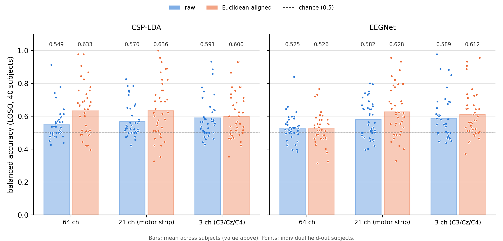
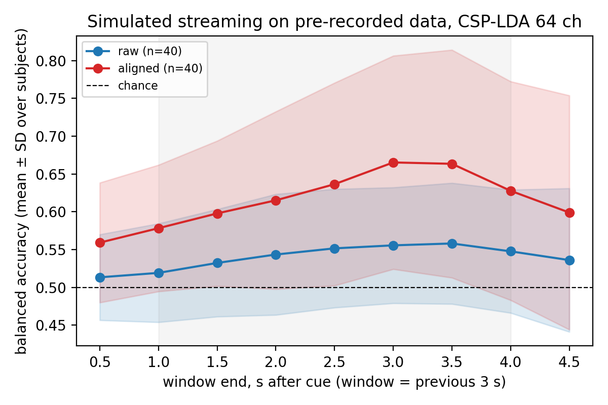

# Subject-independent motor imagery decoding with Euclidean alignment

## 1. Summary

Offline decoding of left- vs right-hand motor imagery on the PhysioNet EEG Motor Movement/Imagery
dataset (40 subjects), evaluated leave-one-subject-out: the classifier never sees labeled data from
the person it is tested on. Unsupervised Euclidean alignment raised CSP-LDA (64 channels) from 0.549 to
0.633 mean balanced accuracy (pre-specified primary comparison). EEGNet did not transfer on 64 channels
(0.526 aligned) but reached 0.628 on the 21-channel motor strip with alignment (exploratory). A
simulated streaming version of aligned 64-channel CSP-LDA, run on the pre-recorded data, gave 0.628
(offline: 0.633), with a median compute time below 1 ms per decision in every subject.
This is **not** a working BCI: everything is offline or simulated on pre-recorded data, with no
feedback loop. At best about half of the subjects are individually above chance.

## 2. Data and preprocessing

| Item | Value |
|---|---|
| Dataset | PhysioNet EEG Motor Movement/Imagery (EEGBCI), loaded with MNE |
| Subjects | 1 to 40 (40 loaded, none skipped) |
| Runs | 4, 8, 12 (imagined left vs right fist) |
| Sampling rate | 160 Hz |
| Filtering | 8 to 30 Hz bandpass (MNE, zero-phase), applied to each run separately before concatenation |
| Reference | Common average reference |
| Epochs | 1 to 4 s after cue onset (481 samples), no baseline correction |
| Labels | T1 = left (0), T2 = right (1) |
| Units | Volts throughout; microvolts only for plotting |
| Trials | 1796 total: 904 left, 892 right |

38 subjects contributed 45 trials each. Subject 34 contributed 43 (21 left, 22 right). Subject 37
contributed 43 (22 left, 21 right). The only rejection is of epochs that overlap run-boundary
annotations. No ICA or other artifact removal is applied.

## 3. Methods

**Evaluation.** Leave-one-subject-out (LOSO): each of the 40 subjects is held out once, and the
model is trained on all other subjects. Every condition uses identical folds through `run_loso` in
`src/subject_independent.py`, with the interface
`fit_predict(X_train, y_train, groups_train, X_test) -> (pred, proba, info)`. The held-out subject's
labels are never used for fitting, scaling, feature selection, hyperparameter selection or early
stopping.

**Conditions.** Two models (CSP-LDA, EEGNet) x three montages (64 channels; 21-channel motor strip
FC5 FC3 FC1 FCz FC2 FC4 FC6, C5 C3 C1 Cz C2 C4 C6, CP5 CP3 CP1 CPz CP2 CP4 CP6; C3/Cz/C4) x
alignment (raw, aligned): 12 conditions. Channels are selected before alignment.

**CSP-LDA** (`src/csp_baseline.py`). Common spatial patterns (MNE, Ledoit-Wolf regularized
covariance, log-variance features) followed by linear discriminant analysis. The number of CSP
components is chosen from {2, 4, 6, 8} (only values up to the number of channels) by an inner
5-fold GroupKFold over the **training subjects only**, scored by balanced accuracy, then refit on all
training subjects. With C3/Cz/C4 only 2 components are possible.

**EEGNet-8,2** (`src/eegnet.py`, `src/train_eegnet.py`; PyTorch, CPU). Standard architecture
(Lawhern et al. 2018): F1 = 8, D = 2, F2 = 16, temporal kernel 80, depthwise spatial convolution with
max-norm 1.0, pooling 4 then 8, separable kernel 16, ELU, dropout 0.25, dense layer with max-norm
0.25. Adam (lr 1e-3), batch 64, cross-entropy, at most 100 epochs, seed 42, reinitialized per fold.
Four **training** subjects (seeded random choice per fold) form a validation set; early stopping on
validation loss with patience 10, restoring the best-validation weights. Input scaling uses fixed
constants with no fitted statistics: raw x 1e6 (volts to microvolts), aligned x 1 (alignment output
is already unit scale). These settings were frozen on 2026-10-23, before any EEGNet LOSO result
existed, and were tuned for 64 channels only; the 21- and 3-channel runs use them unchanged. CPU was
forced because on MPS the same code and seed failed to fit the training data.

**Euclidean alignment** (`src/alignment.py`). For each subject separately, the reference matrix R
is the mean spatial covariance of that subject's trials, and every trial is multiplied by R^(-1/2)
(pseudo-inverse square root, because average referencing makes the data rank-deficient). It uses
only that subject's own unlabeled trials, never labels and never other subjects. For the held-out
subject this is transductive: their R is estimated from all of their trials, including the test
trials, without labels. The method was fixed before any results; no alternative alignment variants
were tried.

**Metrics.** Per held-out subject: accuracy, macro-F1 (labels [0, 1], zero_division = 0),
balanced accuracy and confusion counts. Summaries are across subjects; SD is the sample standard
deviation (ddof = 1). Chance balanced accuracy is 0.5. A subject is **single-class** when every one
of their test trials received the same predicted label.

**Statistics** (`src/summarizeResults.py`). For each pair of conditions, the per-subject difference
in balanced accuracy (B minus A) is tested with a two-sided Wilcoxon signed-rank test (zero
differences dropped). The 95% CI of the mean difference is a percentile bootstrap over subjects
(10,000 resamples, seed 42); CIs are not adjusted for multiple comparisons. Comparisons are in three
tiers:

- **Primary** (1 pair): CSP-LDA, 64 channels, raw vs aligned. Uncorrected. It was designated while
  the aligned condition was partially complete (the method, design and component grid had been fixed
  before any LOSO result).
- **Secondary** (3 pairs): the other CSP-LDA comparisons among 64 channels and C3/Cz/C4, raw and
  aligned. Holm-corrected across these three.
- **Exploratory** (7 pairs): specified **after** the corresponding results existed (motor strip and
  EEGNet). Holm-corrected within their own family of seven. Treat them as hypotheses, not tests.

**Per-subject test against chance.** For each subject and condition, the number of correctly
classified trials is tested against p = 0.5 with a one-sided binomial test (alpha 0.05, no
correction for the 40 subjects). This uses accuracy, not balanced accuracy, which is reasonable
because classes are roughly balanced (about 22 to 23 trials per class per subject). Even if no
subject were decodable, about 2 of 40 would be expected to pass by chance.

**Reproducibility.** `set_seed(42)` is called before each fold. Per-subject predictions and
probabilities are saved under `results/predictions/`, and software versions in
`results/software_versions.json`:

| Package | Version |
|---|---|
| python | 3.13.9 |
| numpy | 2.3.5 |
| scipy | 1.16.3 |
| sklearn | 1.7.2 |
| mne | 1.11.0 |
| torch | 2.10.0 |
| pandas | 2.3.3 |

## 4. Results

All numbers are read from `results/tables/`. With about 45 trials per subject, single-subject
scores are noisy, so the spread across subjects matters as much as the mean.

### Balanced accuracy across the 40 held-out subjects

| Model | Channels | Aligned | Balanced accuracy, mean ± SD | Median | Subjects < 0.55 | Single-class subjects | Subjects above chance (binomial, of 40) |
|---|---|---|---|---|---|---|---|
| CSP-LDA | 64 | No | 0.549 ± 0.097 | 0.512 | 25 | 7 | 5 |
| CSP-LDA | 64 | Yes | 0.633 ± 0.155 | 0.643 | 16 | 0 | 21 |
| CSP-LDA | 21 | No | 0.570 ± 0.102 | 0.526 | 24 | 2 | 10 |
| CSP-LDA | 21 | Yes | 0.636 ± 0.175 | 0.619 | 15 | 0 | 18 |
| CSP-LDA | 3 | No | 0.591 ± 0.121 | 0.565 | 17 | 3 | 10 |
| CSP-LDA | 3 | Yes | 0.600 ± 0.141 | 0.555 | 19 | 0 | 14 |
| EEGNet | 64 | No | 0.525 ± 0.083 | 0.518 | 29 | 3 | 3 |
| EEGNet | 64 | Yes | 0.526 ± 0.094 | 0.524 | 24 | 0 | 3 |
| EEGNet | 21 | No | 0.582 ± 0.113 | 0.562 | 19 | 3 | 15 |
| EEGNet | 21 | Yes | 0.628 ± 0.149 | 0.617 | 12 | 0 | 16 |
| EEGNet | 3 | No | 0.589 ± 0.135 | 0.552 | 19 | 5 | 11 |
| EEGNet | 3 | Yes | 0.612 ± 0.138 | 0.576 | 16 | 0 | 16 |

Accuracy and macro-F1 (mean ± SD) per condition are in `results/tables/csp_lda_2x2_summary.csv`,
`csp_lda_motor_strip_summary.csv`, `eegnet_summary.csv` and `eegnet_subsets_summary.csv`.



*Bars are means across subjects; points are individual held-out subjects; the dashed line is chance.*

### Paired comparisons (balanced accuracy, B minus A)

| Tier | Comparison (B minus A) | Mean diff | 95% bootstrap CI | Improved / worse / equal | Wilcoxon p | Holm p |
|---|---|---|---|---|---|---|
| Primary | CSP-LDA 64 ch: aligned - raw | +0.084 | 0.052 to 0.115 | 32 / 8 / 0 | <0.001 | not corrected |
| Secondary | CSP-LDA 3 ch: aligned - raw | +0.008 | -0.012 to 0.028 | 22 / 15 / 3 | 0.342 | 0.342 |
| Secondary | CSP-LDA raw: 3 ch - 64 ch | +0.042 | 0.017 to 0.067 | 28 / 10 / 2 | 0.003 | 0.008 |
| Secondary | CSP-LDA aligned: 3 ch - 64 ch | -0.033 | -0.060 to -0.008 | 15 / 23 / 2 | 0.029 | 0.058 |
| Exploratory | EEGNet 64 ch: aligned - raw | +0.001 | -0.032 to 0.032 | 22 / 18 / 0 | 0.745 | 0.745 |
| Exploratory | CSP-LDA 21 ch: aligned - raw | +0.066 | 0.025 to 0.109 | 26 / 13 / 1 | 0.008 | 0.025 |
| Exploratory | 64 ch aligned: CSP-LDA - EEGNet | +0.107 | 0.059 to 0.158 | 25 / 15 / 0 | <0.001 | 0.002 |
| Exploratory | EEGNet 3 ch: aligned - raw | +0.023 | 0.002 to 0.044 | 26 / 13 / 1 | 0.034 | 0.068 |
| Exploratory | EEGNet 21 ch: aligned - raw | +0.046 | 0.012 to 0.080 | 29 / 11 / 0 | 0.006 | 0.022 |
| Exploratory | EEGNet aligned: 3 ch - 64 ch | +0.086 | 0.044 to 0.129 | 29 / 10 / 1 | <0.001 | 0.004 |
| Exploratory | EEGNet aligned: 21 ch - 64 ch | +0.102 | 0.056 to 0.150 | 27 / 12 / 1 | <0.001 | 0.002 |

Holm p is within the tier's own family (secondary: 3 pairs; exploratory: 7 pairs).


*CSP-LDA, raw vs aligned. Grey lines are individual held-out subjects, the red line joins the
condition means, the dashed line is chance (0.5).*

### Interpretation

- **Primary result.** On 64 channels, alignment raised CSP-LDA mean balanced accuracy from 0.549 to
  0.633 (mean paired difference +0.084, 95% CI 0.052 to 0.115, 32 subjects improved, 8 worse).
- **Alignment helps CSP-LDA on 64 and 21 channels, not on 3.** On C3/Cz/C4 no benefit was detected
  (+0.008, Holm p = 0.342). The 21-channel result (+0.066, Holm p = 0.025) is exploratory.
- **EEGNet generalized across subjects only with fewer channels.** On 64 channels it stayed near
  chance with or without alignment (0.525 raw, 0.526 aligned). With alignment it reached 0.628 on 21
  channels and 0.612 on 3 channels (exploratory). The settings were fixed for 64 channels and not
  retuned, so these runs do not show why.
- **3 vs 64 channels, raw CSP-LDA.** The 3-channel montage scored higher (+0.042, Holm p = 0.008).
  This probably reflects poor transfer of raw 64-channel CSP-LDA (not tested here). It does not show
  that three electrodes are sufficient. With alignment the difference was -0.033 (Holm p = 0.058,
  inconclusive).
- **Single-class predictions.** Without alignment, between 2 and 7 subjects per condition received a
  single predicted class for every trial (7 for CSP-LDA on 64 channels). With alignment there were
  none in any condition.
- **At best about half of subjects are individually above chance.** The best condition (CSP-LDA,
  64 channels, aligned) has 21 of 40 subjects above chance by the uncorrected binomial test, where
  about 2 would pass by chance alone. Even there, 16 of 40 subjects scored below 0.55.

These results concern zero-label transfer with unlabeled alignment. No experiment with small amounts
of labeled calibration data was run, so no claim is made about how much calibration is saved.

## 5. Simulated real-time demo

`src/realtime_demo.py` replays the pre-recorded data as if it arrived live. It is a **simulation on
pre-recorded data, not a live BCI**: there is no live recording, no user and no feedback. The design
was fixed before running.

- **Model:** CSP-LDA on 64 channels, trained per held-out subject on the other 39 (same inner
  component selection as offline).
- **Causal preprocessing** for training and streaming: 4th-order Butterworth 8 to 30 Hz bandpass
  applied causally (`scipy.signal.sosfilt`, filter state carried across chunks), then average
  reference per sample. This differs on purpose from the offline zero-phase filter, which needs
  future samples. Training epochs (1 to 4 s after the cue, 480 samples) come from these causally
  filtered runs. Without boundary rejection there are 1,800 trials, vs 1,796 offline.
- **Alignment:** training subjects are aligned as offline. For the held-out subject, R is estimated
  only from the unlabeled epochs of their first run (run 4) and then held fixed.
- **Streaming:** runs 8 and 12 are fed in 0.5 s chunks; after each chunk the latest 3 s window gives
  P(right) and a decision. Both versions (raw, aligned) are scored on the same 30 trials per subject
  from runs 8 and 12.
- **Built-in delay:** every decision uses the last 3 s of signal.
- **Pre-specified trial decision:** the window ending 4 s after the cue (the offline epoch window).
  Decisions fall on a 0.5 s grid that is not aligned to the cues, so the nearest decision is used
  (mean absolute offset 0.12 s).

Results across the 40 subjects (`results/realtime/summary.csv`):

| Version | Balanced accuracy, mean ± SD | Accuracy, mean ± SD | Compute per decision, median (ms) | Compute per decision, 95th percentile (ms) |
|---|---|---|---|---|
| Raw | 0.548 ± 0.081 | 0.547 ± 0.084 | 0.282 | 0.660 |
| Aligned | 0.628 ± 0.145 | 0.629 ± 0.144 | 0.429 | 1.359 |

For comparison, offline CSP-LDA on 64 channels gave 0.549 (raw) and 0.633 (aligned). Compute time
covers filtering, referencing, alignment, CSP and LDA for one chunk, measured with
`time.perf_counter` on a laptop CPU; the table shows means over subjects of each subject's median and
95th percentile. The per-subject median stayed below 1 ms in every subject. For the aligned version
the 95th percentile exceeded 2 ms in 4 subjects; subjects 1 and 2 were timed during a test run while
another job was using the CPU.

Using one unlabeled run (run 4) to estimate the alignment, the streaming version scored close to
offline alignment, which uses all of the subject's trials.

**Post-hoc observation (not pre-specified):** in the time-resolved analysis, mean aligned balanced
accuracy peaked at 0.665 for the window ending 3.0 s after the cue. This was not chosen in advance
and should not be read as the demo's accuracy.



*Mean (± SD across subjects) balanced accuracy for windows ending 0.5 to 4.5 s after the cue; each
window covers the previous 3 s. The shaded region is the 1 to 4 s imagery epoch; the dashed line is
chance. An example stream for one subject (chosen by a fixed rule: the lower-median subject by
offline aligned CSP-LDA balanced accuracy) is in `results/realtime/figures/example_stream.png`.*

## 6. Limitations

- **Offline and pre-recorded only.** No online feedback loop; the demo replays recorded data. Nothing
  here measures closed-loop BCI performance.
- **Small per-subject samples.** About 45 trials per subject (30 in the demo), so single-subject
  scores are noisy.
- **Many subjects remain near chance** in every condition; the means hide large between-subject
  variability.
- **EEGNet settings were fixed for 64 channels** and not retuned for the 21- and 3-channel subsets.
- **Exploratory comparisons were specified after the results existed** (motor strip, all EEGNet
  comparisons). Their Holm correction covers only that family; they need confirmation on new data.
- **Offline alignment is transductive** for the held-out subject's unlabeled trials. The demo shows
  that one unlabeled run (run 4) was enough here, but a real system would still need a batch of the
  new user's trials before aligning.
- **No claim that three electrodes are sufficient.** Three channels taken from a 64-channel
  research-grade recording are not the same as a consumer 3-electrode headset (electrode type,
  placement, reference, noise).
- **Scope.** One dataset, 40 subjects, two classes (left vs right fist imagery).
- **Mechanism not proven.** The idea that raw 64-channel failure comes from covariate shift between
  subjects is supported by the single-class predictions and their disappearance after alignment, but
  is not tested here.

## 7. Reproduction

Run everything from the project root. Runtimes are from the logs in `results/logs/` on a laptop CPU.

```bash
# 1. Environment (versions in section 3)
pip install mne scikit-learn scipy numpy pandas matplotlib torch

# 2. Download EDF files and build the cached dataset (data/cache/mi_subjects_1_40.npz)
python -m src.preprocessing

# 3. CSP-LDA 64 ch vs C3/Cz/C4, raw vs aligned (runtime not logged)
python main.py --csp-only

# 4. CSP-LDA 21-ch motor strip, raw vs aligned (about 39 min: 2356 s)
python main.py --motor-strip

# 5. EEGNet 64 ch, raw vs aligned (about 4.2 h: 15000 s)
python main.py --eegnet

# 6. EEGNet C3/Cz/C4 and motor strip, raw vs aligned (about 5.1 h; summed per-fold training time 5.08 h)
python main.py --eegnet-subsets

# 7. Statistics, tables and figures (seconds)
python -m src.summarizeResults

# 8. Simulated real-time demo, 40 subjects (about 3 h)
python -m src.realtime_demo            # quick test: --subjects 1 2
```

For long runs on macOS, prefix with `caffeinate -i` so the machine does not sleep.

Notes:
- Delete `data/cache/*.npz` (or call `load_dataset(use_cache=False)`) after changing any
  preprocessing setting.
- `run_loso` and the demo resume from saved per-subject results. To recompute a condition, delete
  its folder under `results/predictions/` (or `results/realtime/predictions/`).
- `--eegnet`, `--eegnet-subsets` and `--motor-strip` accept `--out-dir` and `--subjects` for quick tests.
- **Known issue:** `python main.py` without a flag fails, because the older KNN/EEGNet electrode
  analysis imports a function that is no longer in `src/subject_independent.py`. Use the flags above.

Folder layout:

```
main.py                    entry point (--csp-only, --motor-strip, --eegnet, --eegnet-subsets)
src/
  preprocessing.py         download, filter, reference, epoch, cache
  alignment.py             per-subject Euclidean alignment
  csp_baseline.py          CSP-LDA fit_predict with inner GroupKFold
  eegnet.py                EEGNet-8,2 model
  train_eegnet.py          EEGNet fit_predict (validation split, early stopping)
  subject_independent.py   run_loso: shared LOSO runner and metrics
  summarizeResults.py      paired tests, bootstrap CIs, binomial test, figures
  realtime_demo.py         simulated streaming demo
  utils.py                 set_seed, log_versions
  (knn_baseline, features, electrode_analysis, ... : older code, not used for these results)
notebooks/                 exploratory analysis only
results/
  tables/                  per-subject and summary CSVs, paired comparisons, above-chance counts
  predictions/             per-subject predictions and probabilities (EEGNet: loss curves)
  figures/                 all_conditions.png, paired_balanced_accuracy.png
  realtime/                demo per_subject.csv, summary.csv, figures/
  logs/                    run logs
  software_versions.json
data/                      not in git
```

## 8. Status

| Experiment | Status |
|---|---|
| Preprocessing, 40 subjects | Done |
| CSP-LDA 64 ch vs C3/Cz/C4, raw vs aligned | Done |
| CSP-LDA 21-ch motor strip, raw vs aligned | Done |
| EEGNet 64 ch, raw vs aligned | Done |
| EEGNet C3/Cz/C4 and motor strip, raw vs aligned (exploratory) | Done |
| Paired statistics (primary, secondary, exploratory) and per-subject binomial tests | Done |
| Simulated real-time demo (pre-recorded data) | Done |

No results are reported for experiments that have not run. `results/electrode_comparison.csv` comes
from an earlier 10-subject run of the older KNN/EEGNet code and is not part of the results above.
