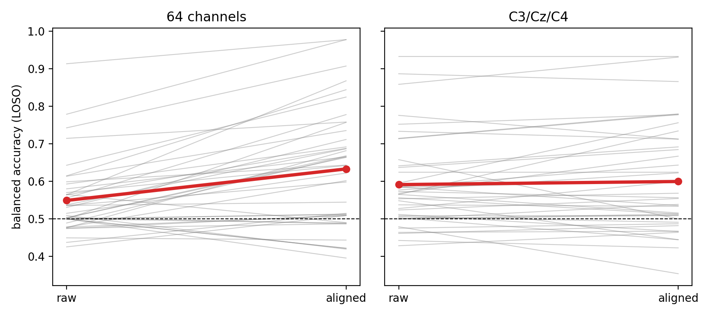

# Subject-independent motor imagery decoding with Euclidean alignment

Offline evaluation of left- vs right-hand motor imagery decoding on the PhysioNet EEG Motor
Movement/Imagery dataset, using full 64-channel EEG and three central electrodes (C3/Cz/C4).
This is a step toward low-calibration brain-computer interfaces (BCIs). It is **not** a working
BCI: everything here is offline analysis of pre-recorded data, with no feedback loop.

## 1. Question

Can unsupervised, per-subject Euclidean alignment reduce the calibration burden of
subject-independent motor imagery decoding? And does the answer differ between the full
64-channel montage and three central electrodes (C3/Cz/C4)?

"Subject-independent" means the classifier is trained on other people and tested on a new
person without any labeled trials from that person. Alignment uses only the new person's
**unlabeled** trials. The primary comparison is raw vs aligned on the full 64-channel montage
(see the note on timing in section 3). The other three paired comparisons are secondary.

## 2. Data

| Item | Value |
|---|---|
| Dataset | PhysioNet EEG Motor Movement/Imagery (EEGBCI), loaded with MNE |
| Subjects | 1 to 40 (40 loaded, none skipped) |
| Runs | 4, 8, 12 (imagined left vs right fist) |
| Sampling rate | 160 Hz |
| Filtering | 8 to 30 Hz bandpass, applied to each run separately before concatenation |
| Reference | Common average reference |
| Epochs | 1 to 4 s after cue onset (481 samples), no baseline correction |
| Labels | T1 = left (0), T2 = right (1) |
| Units | Volts throughout; microvolts only for plotting |
| Trials | 1796 total: 904 left, 892 right |

38 subjects contributed 45 trials each. Subject 34 contributed 43 (21 left, 22 right). Subject 37 contributed 43 (22 left, 21 right). Epochs that overlap run-boundary annotations are dropped.

## 3. Methods

**Evaluation.** Leave-one-subject-out (LOSO): each of the 40 subjects is held out once,
and the model is trained on all other subjects. Every condition uses identical folds through
`run_loso` in `src/subject_independent.py`, with the interface
`fit_predict(X_train, y_train, groups_train, X_test) -> (pred, proba, info)`.
The held-out subject's labels are never used for fitting, scaling, feature selection or
hyperparameter selection.

**Classifier: CSP-LDA** (`src/csp_baseline.py`). Common spatial patterns (MNE, Ledoit-Wolf
regularized covariance, log-variance features) followed by linear discriminant analysis.
The number of CSP components is chosen from {2, 4, 6, 8} (only values up to the number of
channels) by an inner 5-fold GroupKFold over the **training subjects only**, scored by balanced
accuracy. The chosen model is then refit on all training subjects. With C3/Cz/C4 only 2
components are possible, so no selection happens in the 3-channel conditions.
In the 64-channel conditions, the inner search chose 4 components for 15 subjects, 6 components for 12 subjects, 8 components for 13 subjects (raw), and 4 components for 2 subjects, 6 components for 7 subjects, 8 components for 31 subjects (aligned).

**Euclidean alignment** (`src/alignment.py`). For each subject separately, the reference
matrix R is the mean spatial covariance of that subject's trials, and every trial is
multiplied by R^(-1/2). Average referencing makes the data rank-deficient, so a
pseudo-inverse square root is used. Alignment uses only that subject's own unlabeled trials,
never labels and never other subjects. It is applied after channel selection, so the
3-channel conditions are aligned on their own 3x3 covariance. No alternative alignment
variants were tried.

The method (Euclidean alignment), the 2x2 design and the CSP component grid were fixed
before any LOSO results were generated. The statistical plan, with full-channel raw vs
aligned as the primary comparison, was specified while the aligned condition was partially
complete. The remaining comparisons are secondary and Holm-corrected.

**Conditions.** A 2x2 design: full 64 channels vs C3/Cz/C4, each raw vs aligned.

**Metrics.** Per held-out subject: accuracy, macro-F1 (labels [0, 1], zero_division = 0),
balanced accuracy and confusion counts (TN, FP, FN, TP). Summaries are across subjects. SD is
the sample standard deviation (ddof = 1). Chance balanced accuracy is 0.5. A subject is
counted as **single-class** when every one of their test trials received the same predicted
label.

**Statistics** (`src/summarizeResults.py`). For each pair, the per-subject difference in
balanced accuracy (B minus A) is tested with a two-sided Wilcoxon signed-rank test (zero
differences dropped). The 95% confidence interval of the mean difference is a percentile
bootstrap over subjects (10,000 resamples, seed 42). The primary comparison is reported
uncorrected. Holm correction applies to the p-values of the three secondary comparisons.
Bootstrap CIs are not adjusted for multiple comparisons. Aligned 3 vs 64 channels is reported
as inconclusive because it did not survive Holm correction.

**Reproducibility.** `set_seed(42)` is called before each fold. Per-subject predictions and
probabilities are saved under `results/predictions/`, and software versions under
`results/software_versions.json`:

| Package | Version |
|---|---|
| python | 3.13.9 |
| numpy | 2.3.5 |
| scipy | 1.16.3 |
| sklearn | 1.7.2 |
| mne | 1.11.0 |
| pandas | 2.3.3 |

## 4. Results

All numbers below are read from `results/tables/`. With about 45 trials per subject,
single-subject scores are noisy, so the spread across subjects matters as much as the mean.

### Balanced accuracy across the 40 held-out subjects

| Channels | Aligned | Mean | SD | Median | Min | Max | Subjects ≥ 0.70 | Subjects < 0.55 |
|---|---|---|---|---|---|---|---|---|
| 64 | No | 0.549 | 0.097 | 0.512 | 0.426 | 0.913 | 4 | 25 |
| 64 | Yes | 0.633 | 0.155 | 0.643 | 0.396 | 0.977 | 11 | 16 |
| C3/Cz/C4 | No | 0.591 | 0.121 | 0.565 | 0.429 | 0.933 | 8 | 17 |
| C3/Cz/C4 | Yes | 0.600 | 0.141 | 0.555 | 0.354 | 0.933 | 10 | 19 |

### Other metrics

| Channels | Aligned | Accuracy, mean ± SD | Macro-F1, mean ± SD | Single-class subjects |
|---|---|---|---|---|
| 64 | No | 0.550 ± 0.098 | 0.475 ± 0.141 | 7 |
| 64 | Yes | 0.633 ± 0.155 | 0.631 ± 0.156 | 0 |
| C3/Cz/C4 | No | 0.594 ± 0.120 | 0.543 ± 0.154 | 3 |
| C3/Cz/C4 | Yes | 0.599 ± 0.141 | 0.596 ± 0.143 | 0 |

### Paired comparisons (balanced accuracy, B minus A)

| Comparison | Role | Mean diff | Median diff | 95% bootstrap CI | Improved / worse / equal | Wilcoxon p | Holm p |
|---|---|---|---|---|---|---|---|
| alignment effect, full 64 ch | Primary | +0.084 | +0.080 | 0.052 to 0.115 | 32 / 8 / 0 | 0.000041 | not corrected |
| alignment effect, C3/Cz/C4 | Secondary | +0.008 | +0.011 | -0.012 to 0.028 | 22 / 15 / 3 | 0.342 | 0.342 |
| channels (3 vs 64), raw | Secondary | +0.042 | +0.022 | 0.017 to 0.067 | 28 / 10 / 2 | 0.0027 | 0.0082 |
| channels (3 vs 64), aligned | Secondary | -0.033 | -0.043 | -0.060 to -0.008 | 15 / 23 / 2 | 0.029 | 0.058 |



*Grey lines are individual held-out subjects. The red line joins the condition means. The
dashed line is chance (0.5).*

### Interpretation

- **Primary result.** On the full 64-channel montage, alignment raised mean balanced accuracy
  from 0.549 to 0.633. The mean paired difference was +0.084
  (95% bootstrap CI 0.052 to 0.115), Wilcoxon p = 0.000041, with 32 subjects
  improved and 8 worse.
- **Alignment on C3/Cz/C4.** No benefit was detected: mean difference +0.008
  (95% CI -0.012 to 0.028), Holm-corrected p = 0.342.
- **3 vs 64 channels, raw.** The 3-channel montage scored higher: mean difference +0.042
  (95% CI 0.017 to 0.067), Holm-corrected p = 0.0082. This is probably due to raw
  64-channel CSP-LDA transferring poorly across subjects (not tested here). It does not show
  that three electrodes are sufficient.
- **3 vs 64 channels, aligned.** Inconclusive: mean difference -0.033
  (95% CI -0.060 to -0.008), uncorrected p = 0.029, Holm-corrected p = 0.058.
- **Single-class predictions.** Without alignment, 7 subjects on 64 channels and
  3 on C3/Cz/C4 received a single predicted class for every trial. With alignment
  there were 0 and 0. This is why macro-F1 is much lower than accuracy in the
  raw conditions.
- **Many subjects remain near chance.** Even in the best condition (64 channels, aligned),
  16 of 40 subjects scored below 0.55 balanced accuracy.

These results concern zero-label transfer with unlabeled alignment. The comparison against
small amounts of labeled calibration data has not been run, so no claim is made about how much
calibration is saved.

## 5. Limitations

- **Alignment is transductive** for the held-out subject's unlabeled trials. Each subject's
  reference matrix is estimated from all of that subject's trials, including the test trials,
  without labels. A real system would need a batch of the new user's (unlabeled) trials before
  it could align, and these results do not show how many trials that takes.
- **Offline only.** This is pre-recorded data with no online feedback loop, so it says nothing
  directly about closed-loop BCI performance.
- **Hardware.** Three channels taken from a 64-channel research-grade recording are not the
  same as a consumer 3-electrode headset, which differs in electrode type, placement,
  reference and noise.
- **Task.** Two classes only (left vs right fist imagery).
- **Scope.** One dataset and 40 subjects, with about 45 trials per subject.
- **Many subjects remain near chance** in every condition. The mean hides large between-subject
  variability.
- **No claim that three electrodes are sufficient.** The raw 3 vs 64 result is probably due
  to poor transfer of raw 64-channel CSP-LDA rather than adequacy of three channels (not
  tested here).
- **Mechanism not proven.** The idea that raw 64-channel failure comes from covariate shift
  between subjects is a hypothesis. It is supported by the single-class predictions and by
  their disappearance after alignment, but it is not proven here.

## 6. Reproduction

Run everything from the project root.

```bash
# 1. Environment (versions used are listed in section 3)
pip install mne scikit-learn scipy numpy pandas matplotlib

# 2. Download EDF files and build the cached dataset (data/cache/mi_subjects_1_40.npz)
python -m src.preprocessing

# 3. CSP-LDA 2x2 under LOSO (per-subject tables and predictions)
python main.py --csp-only

# 4. Paired statistics, bootstrap CIs and the paired figure
python -m src.summarizeResults
```

Notes:
- `src/preprocessing.py` reads EDF files from (and downloads missing ones into)
  `data/mne_data/`, which MNE organizes as `MNE-eegbci-data/files/eegmmidb/1.0.0/S001/...`. Delete
  `data/cache/*.npz` (or call `load_dataset(use_cache=False)`) after changing any
  preprocessing setting.
- `run_loso` resumes from saved predictions. To recompute a condition from scratch, delete
  its folder under `results/predictions/`.
- **Known issue:** `python main.py` without `--csp-only` currently fails, because the older
  KNN/EEGNet electrode analysis imports a function that is no longer in
  `src/subject_independent.py`. This will be fixed when EEGNet is ported behind `fit_predict`
  (see Status).

Folder layout:

```
main.py                    entry point (CSP-LDA 2x2 with --csp-only)
CLAUDE.md                  project rules and status
src/
  preprocessing.py         download, filter, reference, epoch, cache
  alignment.py             per-subject Euclidean alignment
  csp_baseline.py          CSP-LDA fit_predict with inner GroupKFold
  subject_independent.py   run_loso: shared LOSO runner and metrics
  summarizeResults.py      paired tests, bootstrap CIs, figure
  utils.py                 set_seed, log_versions
  (knn_baseline, features, eegnet, train_eegnet, electrode_analysis, ... : older code, not yet ported)
notebooks/                 exploratory analysis only
results/
  tables/                  per-subject and summary CSVs
  predictions/             per-subject predictions and probabilities
  figures/                 paired_balanced_accuracy.png
  software_versions.json
data/                      not in git
  mne_data/                raw EDF files (MNE-eegbci-data/...)
  cache/                   mi_subjects_1_40.npz
```

## 7. Status

| Experiment | Status |
|---|---|
| Preprocessing, 40 subjects | Done |
| CSP-LDA 2x2 (64 vs C3/Cz/C4, raw vs aligned) | Done |
| Paired statistics for CSP-LDA | Done |
| Riemannian tangent space + logistic regression | NOT DONE (next) |
| KNN baseline ported to `run_loso` | NOT DONE |
| EEGNet under `run_loso` | NOT DONE |
| Calibration experiment (0/5/10 labeled trials from the held-out subject) | NOT DONE |
| Dashboard | NOT DONE |

No results are reported for experiments that have not run. `results/electrode_comparison.csv`
comes from an earlier 10-subject run of the older KNN/EEGNet code. It is not part of the
results above.
